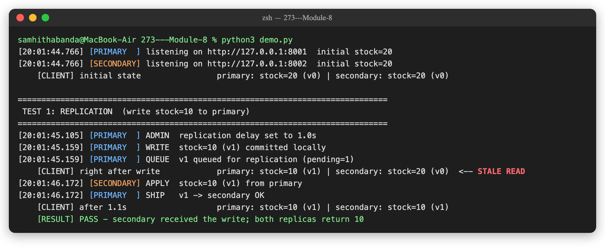
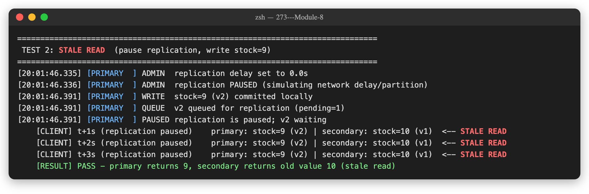
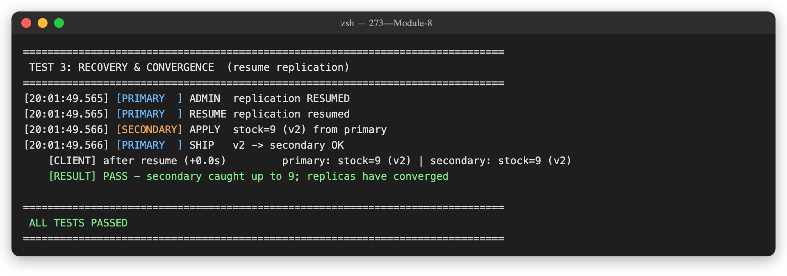

# Module 8 Assignment - Replication & Consistency

## How to Run

Needs Python 3 (no extra packages).

```bash
python3 demo.py
```

This starts the Primary (port 8001) and the Secondary (port 8002) and runs all three tests.

To run things manually instead, open three terminals:

```bash
python3 replica.py --role secondary --port 8002
python3 replica.py --role primary --port 8001 --peer http://127.0.0.1:8002
python3 client.py            # read stock from both replicas
python3 client.py write 9    # write to primary
python3 client.py pause      # pause replication
python3 client.py resume     # resume replication
```

## Architecture

```
            write / read
 Client  ----------------->  Primary (8001)
    |                            |
    |                            | async replication
    |        read                v
    +-------------------->  Secondary (8002)
```

The client writes to the Primary. The Primary saves the value and then sends it to the Secondary in the background. Clients can read from either replica.

## Evidence

### 1. Replication

stock is changed to 10 on the Primary. The Secondary gets the update about 1 second later and both return 10.



### 2. Stale Read

Replication is paused and stock is changed from 10 to 9. The Primary returns 9, but the Secondary still returns 10, which is a stale read.



### 3. Recovery and Convergence

Replication is resumed. The Secondary updates to 9 and both replicas return the same value again.



Full log: [evidence/demo_output.txt](evidence/demo_output.txt)

## Reflection

Reading from a replica is faster and takes load off the primary, but the replica might not have the latest write yet. In my stale-read test, the Secondary still showed stock = 10 after the Primary had already changed it to 9. To make sure a reader always sees the latest value, you have to read from the primary or wait for replication to finish, which makes reads slower and less available if a node is down. So the tradeoff is speed and availability vs. consistency.
